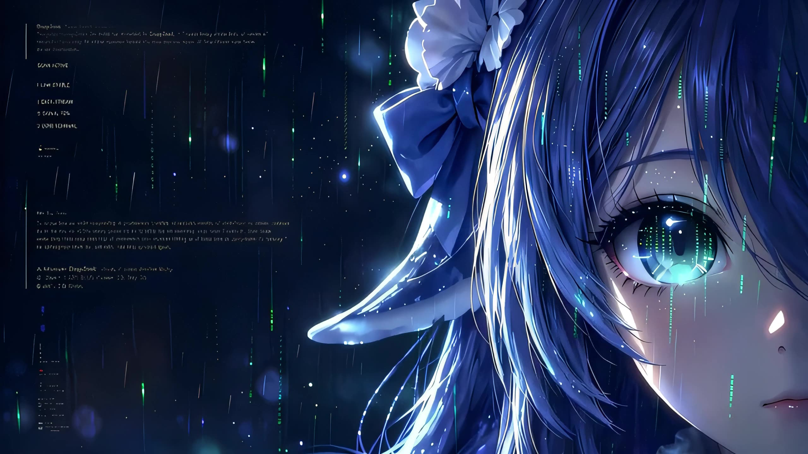

# 鲸鱼娘 · 未至之境 — Windows 11 桌面主题

把 DSH 社区的**鲸鱼娘**皮肤搬到 Windows 桌面上：开机全屏片头 + 桌面动态壁纸 +
可选的登录界面背景，全程由一个托盘程序管着，随时可以暂停、换素材、一键还原。



> 只接管两样东西：**桌面壁纸** 和（可选的）**登录界面背景**。
> 系统的深色模式、强调色、任务栏配色、主题文件一概不碰，你原来什么样就是什么样。

---

## 特性

- **开机片头**：8.06 秒全屏动画，自带音轨，鼠标点一下即可跳过；可静音、可调音量
- **桌面动态壁纸**：mpv 挂到桌面 `WorkerW` 层，无限循环、静音、`panscan` 裁满不变形
- **自定义动画**：托盘 → 修改动画，可上传自己的开机动画 / 背景动画，随时切回默认
- **可逆**：只改壁纸，首次应用时自动快照，随时「停止并还原」
- **开机自启**：走任务计划程序（登录触发），比 Run 键早十几秒，不占「启动应用」列表
- **登录界面背景**：可选，`tools/安装登录界面.cmd` 一键写入 + 可还原

## 托盘菜单

```
修改动画…              上传 / 预览 / 恢复默认（开机动画、背景动画各一份）
暂停动画 / 继续动画    画面定格在当前帧（双击托盘图标同效）
停止并还原            停掉动画，壁纸回到你原来的样子
重播片头              再走一遍全屏片头 + 音效
应用主题（不播片头）   只接桌面层，安静
开机自启              计划任务 + Run 键，勾选状态就是真实状态
片头音效 / 片头音量    静音开关、25% ~ 100%
打开主题文件夹 / 关于
退出                  还原 + 结束进程
```

## 快速开始（用现成的 exe）

1. 到 [Releases](../../releases) 下载 `WhaleTheme.exe`（约 47MB，已内嵌播放内核）
2. 双击运行。首次启动会解压播放内核（约 15 秒，只此一次），然后播一遍片头
3. 想开机自动播放：右键托盘图标 → 勾选「开机自启」
4. 想要登录界面也是这个背景：右键 `WhaleTheme/tools/安装登录界面.cmd` → 以管理员身份运行

## 从源码编译

**前置**

| 需要 | 说明 |
|---|---|
| Windows 10 / 11 | |
| .NET Framework 4.x | 系统自带，用的是 `csc.exe`，无需装 Visual Studio / SDK |
| mpv（**本仓库不含**） | 见下方「准备播放内核」 |

**准备播放内核**（只需一次，或用新版本替换时）

1. 从 https://mpv.io/installation/ 或 shinchiro 的 Windows 构建页下载 mpv
2. 把 `mpv.exe` **拖到** `WhaleTheme/tools/打包播放内核.cmd` 上
   → 生成 `WhaleTheme/build/mpv.exe.gz`（约 45MB，已被 `.gitignore` 排除）

**编译**

```bat
退出托盘的 WhaleTheme.exe   :: exe 运行中无法覆盖，会报 CS0016
双击 WhaleTheme\编译.cmd
双击 WhaleTheme\WhaleTheme.exe
```

`编译.cmd` 会做三件事：把 `build/mpv.exe.gz` 作为内嵌资源打包、用 `/win32icon` 嵌入
`assets/whale.ico`、输出约 47MB 的单文件 exe。

**只想检查语法**：双击 `WhaleTheme/tools/build_check.cmd`（不带资源，编到临时目录，不碰正式 exe）。

### 给贡献者：语法限制

源码按 **C# 5** 编写——系统自带的 csc 只支持到 C# 5。所以：

- ❌ 不能用字符串插值 `$"{x}"`、`?.`、`?.Invoke()`、表达式体成员 `=>`
- ❌ 不能用 `nameof`、`out var`、元组、局部函数
- ✅ 可以用匿名方法 `delegate { ... }`、`var`、LINQ、`using` 语句

改动后请先跑 `tools/build_check.cmd` 确认零警告/零错误，并保持单文件结构。

## 自定义动画

托盘右键 → **修改动画…**

| 区块 | 按钮 |
|---|---|
| 开机动画（全屏片头） | 选择视频… / 预览片头 / 恢复默认 |
| 背景动画（桌面循环） | 选择视频… / 恢复默认 |

- 默认素材**永远不会被覆盖**；上传的视频复制到 `%LOCALAPPDATA%\WhaleTheme\custom\`
  （固定命名 `boot.*` / `background.*`），`config.ini` 里两个开关决定用哪套
- 开关开着但文件丢了会自动回退默认，不会黑屏
- 换背景动画**当场生效**；换开机动画可点「预览片头」立刻看效果
- 程序会自动从视频里抽两帧兜底图：首帧当壁纸（防露旧桌面）、片头末帧当渐隐底图（防闪黑）

建议：MP4（H.264）最稳；片头 16:9、5~20 秒、可带音轨；背景 16:9、2~15 秒无缝循环；
单文件别超过 800MB。

## 还原到底还原了什么

「停止并还原」依据首次应用时写的快照（`%LOCALAPPDATA%\WhaleTheme\snapshot.txt`），只回滚：

1. 壁纸路径 → 换回你原来的图片
2. 填充方式 → `WallpaperStyle` / `TileWallpaper`

因为程序压根没动深色模式、强调色这些东西，所以也不需要还原它们。
**登录界面背景不在主程序还原范围内**（它写在系统目录，需要管理员），
要撤掉请运行 `tools/还原登录界面.cmd`。

## 目录结构

```
win11-whale/
├─ README.md                 本文件
├─ LICENSE                   代码许可（MIT）
├─ LICENSE-ASSETS.md         素材许可（CC BY-NC-SA 4.0）+ 署名
├─ NOTICE                    mpv / GPL 声明
├─ .gitignore / .gitattributes
└─ WhaleTheme/
   ├─ WhaleTheme.cs          全部逻辑，单文件，C# 5
   ├─ 编译.cmd               调系统自带 csc 生成 exe
   ├─ 说明.txt               详细说明书（故障排查看这里）
   ├─ assets/                片头、循环、首帧、登录图、图标
   ├─ build/                 mpv.exe.gz 放这里（不入库，.gitkeep 占位）
   └─ tools/
      ├─ 安装登录界面.cmd / 还原登录界面.cmd
      ├─ 打包播放内核.cmd    mpv.exe → build/mpv.exe.gz
      ├─ build_check.cmd     语法检查
      ├─ ico_check.cmd       验证 ico 能否被 csc 接受
      ├─ make_ico.py         PNG 组 → assets/whale.ico
      └─ icon-src/           图标源图（7 个尺寸）
```

## 已知限制

1. 主板 logo 和 Windows 转圈那几秒改不了（固件层），本主题只管「桌面出现之后」
2. 素材是从源片超分到 2560×1440 的，放大看边缘仍偏软——这是素材决定的，不是渲染问题
3. 桌面循环只有 2.58 秒，盯着看能数出节奏（原作者的无缝眨眼片段）
4. 桌面层挂在 `WorkerW` 窗口里，某些桌面整理软件可能改变这个结构；程序会自动在三种宿主里挑，
   全挑错时会停在静态首帧，看 `%LOCALAPPDATA%\WhaleTheme\log.txt` 里的「挂载成功 / 20 次重试后仍未挂上」
5. 出问题先看日志：`%LOCALAPPDATA%\WhaleTheme\log.txt`

更多细节（每个脚本干什么、声音规则、自启原理）见 [`WhaleTheme/说明.txt`](WhaleTheme/说明.txt)。

## 许可证

| 部分 | 许可 |
|---|---|
| 代码（`.cs` / `.cmd` / `.py`） | **MIT** — 见 [LICENSE](LICENSE) |
| `assets/` 素材、图标源图 | **CC BY-NC-SA 4.0** — 见 [LICENSE-ASSETS.md](LICENSE-ASSETS.md)，**禁止商用** |
| 内置 mpv（未随仓库分发） | **GPL v2+** — 见 [NOTICE](NOTICE) |

署名（按创作顺序）：**上善**（角色形象原作）→ **ZipZipPipe**（DeepSeek 元素二次设计）→
**Small-tailqwq**（dsh-deep-whale 皮肤再设计）→ **上山吃老虎**（超分再渲染 + Windows 移植）。

自己电脑上用随便用；**不许商用、不许卖**；分享给别人请保留上面这几位署名并沿用同一协议。

---

## English

A Windows 11 desktop theme built around the *Whale* character skin from the DSH
community: a full-screen boot animation, a looping animated wallpaper hosted on the
desktop `WorkerW` layer via mpv, and an optional logon-screen background. Everything
is controlled from a tray app and is fully reversible. Users can drop in their own
boot / background videos from the tray menu.

Written in a **single C# 5 file** and compiled with the .NET Framework's bundled
`csc.exe` — no Visual Studio or SDK required. mpv is **not** shipped in this repo;
see [NOTICE](NOTICE) for how to supply it and what GPL compliance requires.

Code is **MIT**; media assets are **CC BY-NC-SA 4.0** (no commercial use).
